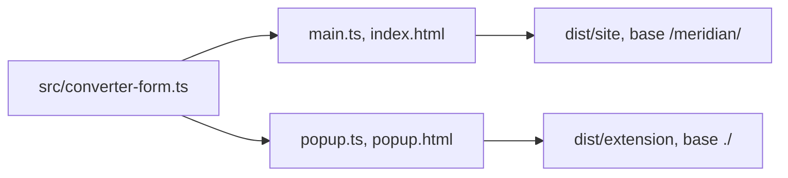

# Builds and the converter form

`pnpm build` in this package runs two Vite builds: the site, then the extension popup.

## Site

[vite.config.ts](../../../../vite.config.ts) builds `index.html` into `dist/site` with base `/meridian/` for GitHub Pages.

## Extension popup

[vite.config.extension.ts](../../../../vite.config.extension.ts) builds `popup.html` into `dist/extension` with relative asset paths, no module preload and no inlined assets, so the popup has no inline script. A plugin emits `manifest.json` from `extension/manifest.json`, setting `version` from `package.json` through `writeManifestVersion` in `src/manifest-version.ts`. That function throws unless the version is 1 to 4 dot-separated integers.

## Converter form

`mountConverter(root)` in `src/converter-form.ts` renders the form shared by the site (`main.ts`) and the popup (`popup.ts`), styled by `src/styles.css` (the Calm Teal theme, defined as role tokens with light and dark palettes). It labels every control, shows the result in a polite live region and reports bad input through an alert tied to the input with `aria-invalid` and `aria-describedby`.

Input is trimmed and must be a plain decimal: an optional sign, digits, and a `.` or `,` decimal separator. `1,000`, `0x1F` and `1e3` are rejected.
